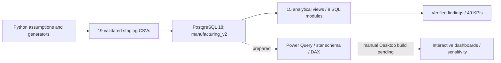

# Manufacturing 360 BI

An end-to-end Business Intelligence portfolio for a **fictional automotive-parts manufacturer**: deterministic Python simulation, reconciled manufacturing accounting, PostgreSQL analytics and a complete Power BI implementation handover. All data and business findings are synthetic.

## Business questions

- Which products and customers generate revenue, gross profit and contribution after distribution costs?
- How do materials, labor, energy and overhead flow through production, inventory and sales COGS?
- Where do utilization, defects, purchasing concentration and inventory investment merit investigation?
- How sensitive is historical profit to selling prices and six independent cost/price drivers?

## Status: executed versus prepared

**Completed and validated:** 19 revised CSV datasets; monthly weighted-average component costing; live PostgreSQL 18 schema manufacturing_v2 inside manufacturing_360; 15 analytical views; eight SQL business-analysis modules; 49 KPI definitions; independent scenario reference tests.

**Prepared, not executed in Power BI:** star schema, 22 Power Query scripts, 120 core DAX measures, 22 final scenario measures and six parameters. No v2 dashboard, semantic-model refresh or DAX runtime validation is claimed. The existing local PBIX is a legacy artifact, not evidence of a completed v2 dashboard.

Start the independent build with [POWER_BI_START_HERE](docs/POWER_BI_START_HERE.md). No ChatGPT Plus or Codex subscription is required to follow the supplied files and manual instructions.

## Architecture



Python models engineering BOMs, product-specific labor/energy activities, line support/standby pools, procurement, defects, capacity and shipments using explicit seeds. Financial logic preserves purchase materials, inbound freight, labor, energy and overhead through inventory and sales. Outbound freight is a distribution expense; fixed and revenue-variable selling remain distinct. No prices or costs are backsolved to target profit margins.

SQL aggregates facts to compatible grains before joining, with keys, constraints and independent reconciliation queries. The active migration is **schema-only**; the separate-database Phase 8A design is retired and must not be executed.

## Verified financial findings

| EUR unless % | 2024 | 2025 | Combined |
|---|---:|---:|---:|
| Net revenue | 10,559,374.25 | 10,973,277.52 | 21,532,651.77 |
| Manufacturing COGS | 8,095,663.36 | 8,411,512.20 | 16,507,175.56 |
| Gross profit | 2,463,710.89 | 2,561,765.32 | 5,025,476.21 |
| Operating profit | 1,191,810.42 | 1,258,943.35 | 2,450,753.77 |
| Operating margin % | 11.28675234 | 11.47281063 | 11.38156970 |

Revenue grew 3.92% in 2025; operating profit grew 5.63%. Combined product gross margins range from 12.80% to 34.09%. The top five customers account for 23.23% of 2025 revenue. All 144 observed supplier receipts are on time, limiting reliability comparisons. These are descriptive synthetic results, not real-company impact claims.

[Executed SQL findings](sql/analytics/BUSINESS_FINDINGS.md) include full definitions, grains and limitations. [Scenario reference results](reports/phase9b_20261024T234841/FINANCIAL_RECONCILIATION.md) cover all requested shocks. The labor sensitivity targets direct labor only; support labor remains fixed through a documented analytical decomposition of existing COGS. Scenarios are static historical exposure tests, not forward-looking forecasts or revalued inventory ledgers.

## Repository map

| Path | Purpose |
|---|---|
| scripts/ | Assumptions, exclusive-output generators and reproducibility/security helpers |
| data/staging/ | Approved revised 19-dataset import candidate; unchanged |
| data/processed/ | Legacy synthetic baseline, retained for compatibility/regression tests |
| sql/v2/existing_schema/ | Active guarded schema migration and 36 model checks |
| sql/analytics/ | Eight analysis modules, 83 portfolio gates and KPI dictionary |
| powerbi/phase9a/ | Base model, M queries, 120 core measures and acceptance queries |
| powerbi/phase9b/ | Final scenario overlay, direct-labor exposure and reference calculator |
| docs/ | Reproduction, independent Desktop handover and publication guidance |
| reports/ | Selected public findings/results; verbose local snapshots are ignored |
| tests/ | Non-destructive Python regression tests |

Historical backups, external raw data, PBIX binaries, credentials, local report pointers and generated ZIPs are excluded from publication but not deleted. [Security/publication policy](docs/SECURITY_AND_PUBLICATION.md) explains why. Raw external datasets are not generation inputs; redistribution rights were not established, so they are not included in the public profile.

## Reproduce and review

Validated environment: Windows, Python 3.12, numpy 2.3.5, pandas 3.0.1, tzdata 2026.5 and PostgreSQL 18. Optional pglast 8.7 supports static SQL checks. Other environments and a fresh dependency installation have not been certified.

```powershell
python -m venv .venv
.\.venv\Scripts\python.exe -m pip install -r requirements-dev.txt
.\.venv\Scripts\python.exe -B -m unittest discover -s tests -v
```

Run `python -B scripts/run_final_acceptance.py` for the isolated, non-destructive acceptance suite after installing requirements-dev.

Use the supplied validated CSVs rather than regenerating them. [Reproduction instructions](docs/REPRODUCIBILITY.md) cover safe authentication, conditional schema import, read-only SQL validation, analytics and scenario checks. The importer refuses an existing manufacturing_v2 schema; no automatic reset or destructive retry is provided. Never run generation against the existing staging/processed datasets.

[Independent Power BI handover](docs/POWER_BI_START_HERE.md) gives the exact Phase 9A → Phase 9B order, table/relationship lists, measure installation, pages and acceptance tests. The offline ZIP builder packages the public project assets with hashes; third-party installers/wheels are not bundled.

## Tools and analytical techniques

Python/pandas/numpy; PostgreSQL 18 and psql; SQL CTEs, joins, window functions, ranking, conditional aggregation and reconciliations; Power Query M and DAX preparation; integer-cent allocation and Decimal scenario math; SHA-256 manifests and regression tests.

## Limits and remaining work

Power BI connector/M/DAX execution, model relationships, slicers, visuals, refresh and report publishing remain manual acceptance gates. Inventory uses monthly midpoint averages for turnover; no WIP/daily inventory or machine-level OEE exists. Sales COGS lacks material/supplier-specific lineage. Demand elasticity, purchasing lag, cash flow and prospective scenario revaluation are outside scope. Direct/support labor exposure is a reconciled analytical attribution, not a separately booked source component.

[Final acceptance](docs/FINAL_ACCEPTANCE.md) separates verified results from pending Desktop tests. [Publication checklist](docs/GITHUB_PUBLICATION_CHECKLIST.md) requires manual review, repository/license choices and explicit approval before any commit/push. No Git repository, remote or branch was configured at audit time; no commit, push or publication was performed. No open-source license grant has been assumed.
