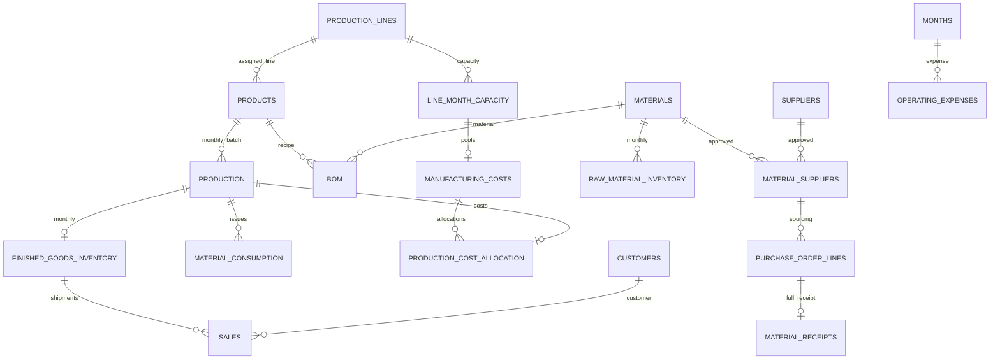

> Phase 8B update: the live target is the existing database `manufacturing_360`, schema `manufacturing_v2`. Translate erp.X to manufacturing_v2.X, bi.X to manufacturing_v2.bi_X, and audit.X to manufacturing_v2.audit_X. See [active migration](../sql/v2/existing_schema/README.md) and [Power BI connection guide](power_bi_v2_connection.md). The separate-database descriptions below are Phase 8A history.

# PostgreSQL v2 architecture

Authoritative baseline: docs/financial_model.md, the 19 staging CSVs and reports/phase7_20261024T141247792082+0200. No database migration was executed.

## Schema and relationships

`erp` mirrors all 19 source datasets. `bi` provides 15 analytical views. `audit` stores file/financial expectations and provides two validation views. The [dictionary](../sql/v2/data_dictionary.md) lists every actual column, type, grain, row count, key and foreign key. The contract records every CHECK expression.

Identifiers are text, preserving formatting; dates/months are DATE, counts integer. Exact NUMERIC uses money 2 decimals, kg quantities 3, activity/rates 4, weighted-average unit costs 8, percent fields 4 and the on-time ratio 6. Every source value was checked for precision/scale. Source columns are required, numbers finite, and relevant costs/quantities nonnegative. Signed returns/credits need future design.

Primary/unique keys define grains. Composite foreign keys preserve production/month/product agreement and product/assigned-line agreement. Sixteen explicit indexes supplement primary/unique indexes. Foreign keys are immediate; loading is parent-first. Partial receipts are deliberately unsupported by the current one-complete-receipt-per-PO uniqueness policy.

The diagram summarizes core paths; the dictionary includes calendar and other composite foreign keys. Cross-table accounting identities are checked by import-time audits rather than unsafe cross-table CHECK expressions.

## Analytical grains and duplicate prevention

- `production_performance`: batch; `line_production_performance`: line/month, production aggregated before capacity joins. Defect rates use defective/attempted units.
- `manufacturing_cost_components`: batch allocation, five components, capitalization and losses. `line_manufacturing_costs`: line/month pools and idle expense. Pools and allocations are alternative views of costs, never additive facts.
- `sales_detail`: shipment line with unique dimensions; `customer_month_performance`: customer/month.
- `product_month_profitability`: product/month, sales aggregated before inventory/allocation joins. `product_profitability`: additive flows over the reporting period. Product contribution after freight does not invent shared administration allocations.
- `raw_material_inventory`, `finished_goods_inventory`: monthly snapshots, not additive across months.
- `procurement_receipts`: receipt; `procurement_order_status`: PO line after receipts aggregate to that grain; `material_consumption`: production/material issue.
- `monthly_pnl`: independently aggregates sales, opex, idle and abnormal losses before calendar joins. `period_pnl`: annual and combined rows, margins calculated from summed numerators/denominators. Never add combined and annual rows together.

Never join sales lines directly to material issues, or repeat monthly allocations across shipment rows before summing. Shared month/product keys do not make facts safe to join without aggregation.

## Accounting and reconciliations

Purchase-only receipt value + inbound freight = landed receipt value. Monthly weighted-average raw inventory retains both components. Manufacturing and finished goods retain purchase material, inbound freight, labor, energy and overhead. Legacy material_cost_eur remains landed and must not be added to its two components again. Fully defective production is expensed, not capitalized.

Each inventory component satisfies opening + additions − issues/COGS = closing and exact carry-forward. Sales-row component totals reconcile to monthly inventory COGS. Inbound freight enters inventory/COGS once; outbound freight is a shipment selling/distribution expense below gross profit, excluded from opex CSV and manufacturing pools.

Operating profit = revenue − manufacturing COGS − outbound freight − selling − administration − idle costs − abnormal production losses. Analytical views calculate from facts and never read audit expectations. The 36 audit checks include activity allocation, cent allocation, quantities, receipts, roll-forwards, conservation and 33 baseline metric comparisons. EUR comparisons are exact; percentage tolerance is 0.00000001 percentage points. Failures raise before COMMIT.

## Existing half-cent compatibility

February 2024 L01 labor is booked at EUR 96,531.70 although stored hours × rate is exactly EUR 96,531.705. PostgreSQL NUMERIC rounds this to EUR 96,531.71. This is an existing Python floating-point tie effect. Direct labor/energy CHECKs permit the lower cent only at an exact half-cent, not a general cent tolerance. All component conservation and approved P&L totals remain exact. Preserve this approved candidate; a future versioned generator improvement should use Decimal consistently.

## Remaining execution gate

The PostgreSQL 18 parser checked SQL/PLpgSQL syntax and offline names, keys, precision and every planned row CHECK against source data. The 36 SQL audit queries have not executed on a server. Server type/operator resolution, COPY, transaction rollback, ownership, encoding environment and performance still require an authorized integration run. See the [execution guide](../sql/v2/README.md).
