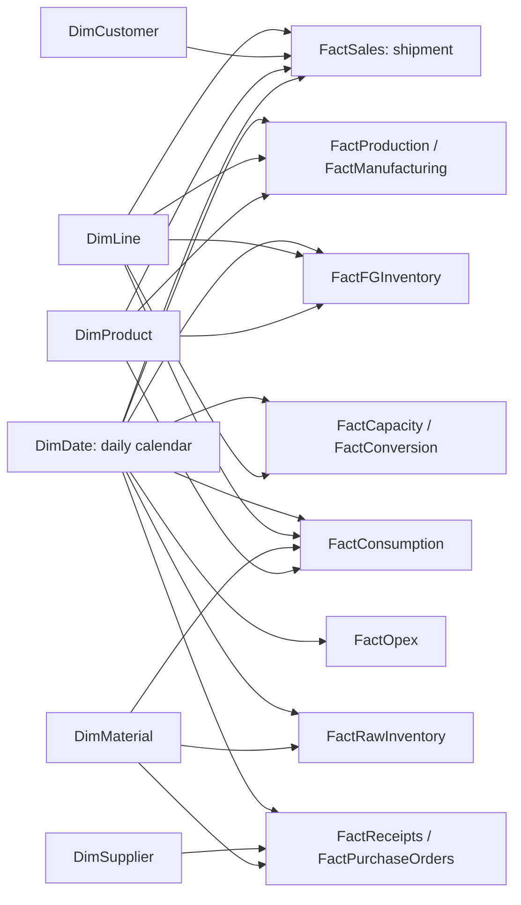

# Power BI star-schema specification

Target: PostgreSQL manufacturing_360.manufacturing_v2; new Power BI Import model. Existing PBIX files are out of scope. [Machine-readable model](model_spec.json), [table mapping](TABLE_MAPPING.csv) and [all exact relationships](RELATIONSHIPS.csv) are authoritative.

## Tables and grains

| Model table | Live source / construction | Grain / key | Rows |
|---|---|---|
| DimDate | Power Query generated calendar bounded by live SQL dates | one calendar day, full years / Date | 731 |
| DimProduct | products | one product_id / product_id | 20 |
| DimCustomer | customers | one customer_id / customer_id | 25 |
| DimMaterial | materials | one material_id / material_id | 10 |
| DimSupplier | suppliers | one supplier_id / supplier_id | 15 |
| DimLine | production_lines | one line_id / line_id | 3 |
| FactSales | bi_sales_detail | shipment line / sales_line_id | 2596 |
| FactProduction | bi_production_performance | product/month batch / production_id | 480 |
| FactManufacturing | bi_manufacturing_cost_components | production batch allocation / production_id | 480 |
| FactConversion | bi_line_manufacturing_costs | line/month cost pool / month_id, line_id | 72 |
| FactCapacity | line_month_capacity | line/month capacity / month_id, line_id | 72 |
| FactReceipts | bi_procurement_receipts | receipt (one complete receipt per PO line) / receipt_id | 144 |
| FactPurchaseOrders | bi_procurement_order_status | purchase-order line / po_line_id | 144 |
| FactRawInventory | bi_raw_material_inventory | material/month snapshot / month_id, material_id | 240 |
| FactFGInventory | bi_finished_goods_inventory | product/month snapshot / month_id, product_id | 480 |
| FactOpex | operating_expenses | month/expense category / month_id, expense_category | 48 |
| FactConsumption | bi_material_consumption | production batch/material issue / production_id, material_id | 1536 |
| RefPnL | audit_expected_pnl | approved reference period (annual and combined) / period | 3 |
| RefMonthlyPnL | bi_monthly_pnl | reference month / month_id | 24 |

Six dimensions, eleven facts and two disconnected reconciliation references form the core model. Optional sensitivity adds six disconnected single-column parameter tables. Do not import the remaining customer/product/month/period aggregate views as additional business facts; they overlap the detailed facts already loaded. BOM and approved supplier bridges are not required for the 49 approved KPIs and are intentionally excluded from automatic filter propagation.

## Relationship rules

All 30 active relationships are dimension-to-fact, 1:* with Single filter direction. Four additional Date roles are inactive. DimDate[Date] is unique; its MonthStart column is not unique and is never a relationship one-side key. For monthly facts DimDate[Date] connects to the stored month_id. Receipts use M-derived ReceiptMonth; purchase orders use M-derived OrderMonth. No surrogate or concatenated composite key is needed because dimensions have single-column natural keys; composite fact grains are documented, not related fact-to-fact.

No dimension-to-dimension edges, fact-to-fact links, many-to-many relationships or bidirectional filtering are permitted. In particular, do not relate DimLine to DimProduct: both independently filter the facts that carry line_id/product_id. Hide DimProduct[line_id] and use DimLine for line slicers. A line slicer will not automatically reduce the visible product dimension list; a visual-level nonblank measure filter can do that without changing relationships.

The diagram summarizes active paths. RefPnL and RefMonthlyPnL have **no relationships**. Their purpose is validation, not revenue/expense aggregation. The CSV lists every path, including inactive ones. Disable automatic relationship detection before importing to avoid unwanted RefMonthlyPnL or overlapping Date links.

## Date roles and reporting scope

DimDate is a complete daily calendar bounded dynamically to full years covering accounting months and actual/expected procurement/shipment dates. Current verified coverage is 2024-01-01 through 2025-12-31: 731 unique dates. Mark DimDate[Date] as the Date table; disable Auto date/time. Sort MonthName by MonthNumber and YearMonth by YearMonthSort. Use Year → Quarter → YearMonth on accounting pages.

Monthly financial/production/inventory measures require complete calendar months. A partial-day filter returns BLANK through Complete Month Context. This prevents first-of-month monthly records from being misinterpreted as daily costs. Do not use a day range slider on executive/monthly pages. Full-year selections still contain all daily Date rows, so classic DATEADD and TOTALYTD operate on the shared calendar. The monthly source relationship attributes each fact to its accounting month, not to a claim about activity on day one.

Inactive role relationships are DimDate[Date] to FactSales[shipment_date], FactReceipts[receipt_date], FactPurchaseOrders[order_date] and FactPurchaseOrders[expected_receipt_date]. The four supplied daily role measures activate the intended role with USERELATIONSHIP and bypass monthly guards. They are operational date views only. Company OP has no daily allocation and remains BLANK on partial-day contexts. Do not combine daily revenue with monthly production/opex on one daily P&L visual. No separate daily calendar-to-month bridge is needed.

## Scope and non-additivity

Company Operating Profit, selling/admin and company validation are Date-only. Unsupported Product, Customer, Line, Material or Supplier filters make company OP BLANK because shared costs have no approved attribution. Use Contribution after Outbound for product/customer analysis. Capacity denominator and pool rates support Date/Line, not product allocation. Raw inventory supports Date/Material; FG supports Date/Product/Line; combined inventory is company-only. Inventory turnover requires one full year.

Unrelated dimensions do not filter a fact: Supplier/Material cannot explain customer sales, and Customer cannot explain production. Keep page slicers aligned to the supporting facts. Supplier-to-sales or material-to-COGS drill-through would require additional lineage not present in the five aggregated sales COGS components. Do not create a bridge to imply that missing lineage.

Do not add line cost pools to their product allocations, landed material aggregate to purchase/freight components, or capitalized additions to COGS. Snapshot closing values use the latest selected month; average inventory uses monthly opening/closing midpoints. Never sum month-end snapshots or YTD values across time.

## Missing prerequisites

No new SQL view or database object is required for the requested model. The only missing denormalized attribute is consumption line_id; its supplied SELECT joins products on the unique product_id. M creates receipt/order month keys and the Date table. Every projection is executable read-only SQL in validation/source_queries.sql. All source keys and relationship coverage are validated against live data. Daily inventory/WIP, detailed supplier/material attribution through finished goods and causal process data do not exist and are outside this model.
